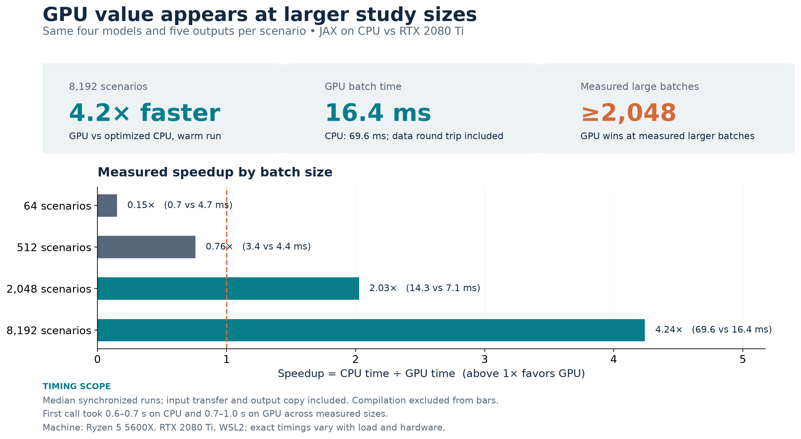
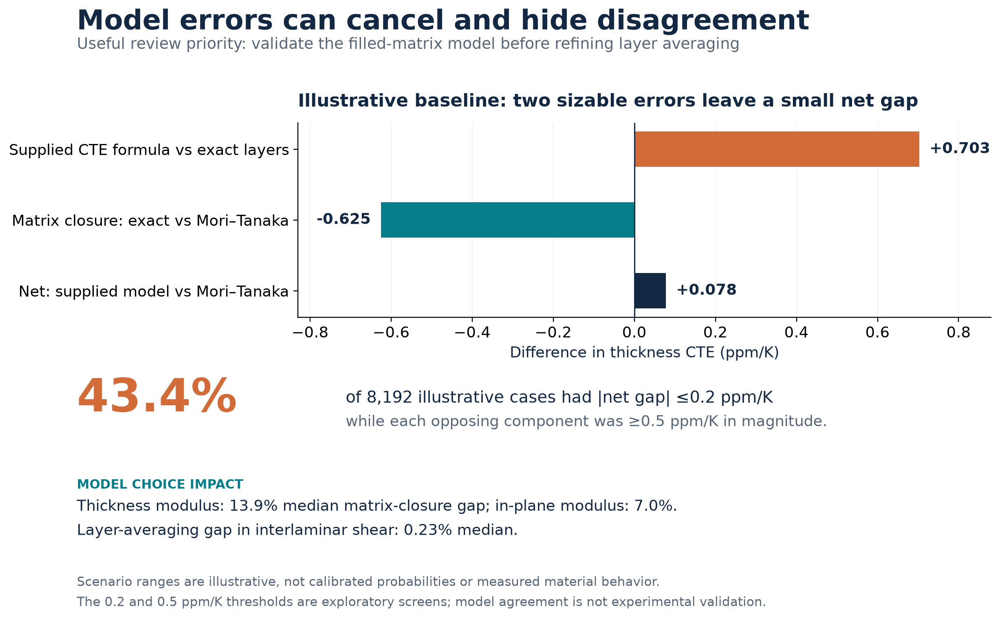

# Executive brief: GPU acceleration and model review

## Decision in one minute

The existing RTX 2080 Ti speeds this four-model scenario calculation when
batches are large. At 8,192 scenarios, the measured median was **16.4 ms on
GPU versus 69.6 ms on an optimized JAX CPU path**, including input transfer
and output copy: **4.24× faster**. At 64 and 512 scenarios, the CPU was faster.
Compilation adds roughly 0.6–1.0 seconds on a first call, so this hardware
is most useful for repeated large studies, not one small calculation.

The larger study revealed a model review issue. At the illustrative baseline,
the supplied thickness thermal-expansion formula is **+0.703 ppm/K** relative
to the exact-layer result using its matrix model. Changing that matrix model
to Mori–Tanaka shifts the result by **−0.625 ppm/K**. The net difference
between the supplied prediction and the Mori–Tanaka prediction is only
**+0.078 ppm/K**. Apparent agreement between those two predictions can
therefore conceal compensating model assumptions. It is not evidence that
either prediction matches a real material.

## Measured results

| Scenarios | JAX CPU, ms | JAX GPU, ms | CPU time / GPU time |
|---:|---:|---:|---:|
| 64 | 0.7 | 4.7 | 0.15× |
| 512 | 3.4 | 4.4 | 0.76× |
| 2,048 | 14.3 | 7.1 | 2.03× |
| 8,192 | 69.6 | 16.4 | 4.24× |

Each scenario computes five engineering outputs under four model variants.
Times are medians of synchronized, compiled calls with transfer in both
directions; they exclude first-use compilation. The measured crossover lies
between 512 and 2,048 scenarios on this machine. The original scalar NumPy
implementation took 1,215 ms for 2,048 scenarios, showing that batching and
JIT compilation supply most of the improvement before GPU choice matters.
These are computation timings, not the runtime of the whole research workflow.

## Study result worth acting on

Across 8,192 deterministic scrambled-Sobol draws in the declared illustrative
input ranges, the median filled-matrix closure difference was **13.9% for
thickness modulus** and **7.0% for in-plane modulus**. The median discrepancy
from layer averaging in interlaminar shear was **0.23%**. Every draw had a
thickness-modulus closure gap above 10% within these chosen ranges.

For 43.4% of draws, the supplied model and Mori–Tanaka model predicted
thickness CTE within 0.2 ppm/K of each other even though their two opposing
model components each differed by at least 0.5 ppm/K. These thresholds are
exploratory screens. The draws are scenario coverage, **not calibrated
probabilities or confidence intervals**.

The next engineering investment should be matched measurements of the actual
filled resin and laminate, including its silica packing, porosity and thermal
expansion. Those data can determine which matrix description is credible and
whether the apparent CTE agreement is real. Use GPU batching for subsequent
large sensitivity or calibration campaigns; use CPU for small reviews.

## Evidence and limits

The GPU path reproduces the saved 493-case grid and 512-case uncertainty
results to maximum absolute differences of 3.6×10⁻¹⁴ and 2.9×10⁻¹⁴,
respectively, for all comparable saved values. All 14 project tests pass
under the CUDA backend. Raw timings and extended results are in
`results/raw/performance_cpu.json`, `results/raw/performance_gpu.json`, and
`results/raw/extended_study_gpu.json`. The exact commands are in
`REPRODUCIBILITY.md`.

This is a numerical comparison of uncalibrated models, not material
validation. Hardware, driver state, process load and batch shape can change
timings; the performance claim applies to this machine and these equations.
