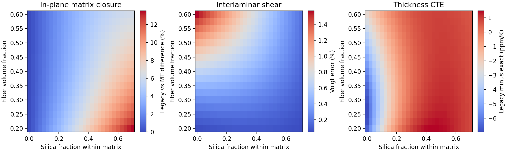
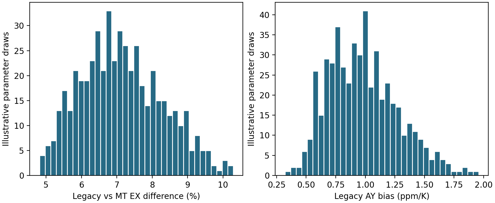

# A reproducible thermoelastic audit of a glass-fiber / silica-filled polymer cross-ply

## Abstract

We independently audited a supplied hierarchical micromechanics script for a
50/50 0/90 glass-fiber cross-ply with silica-filled resin. We implemented the
script's constituent formulas, thermally consistent uniform-strain averaging,
exact flat-layer thermoelastic homogenization, an independent constrained-
energy numerical reference, and an alternative bonded-sphere Mori–Tanaka
filled-resin closure. At the illustrative input, exact homogenization gives
in-plane modulus 36.921 GPa, through-thickness modulus 30.591 GPa, in-plane
CTE 6.529 ppm/K and thickness CTE 9.407 ppm/K. Consistent uniform-strain
averaging agrees with exact CTE to floating-point precision; its largest
reported elastic difference is 0.153% in interlaminar shear. The script's
separate CTE formulas instead report 6.465 and 10.110 ppm/K. Changing the
filled-resin stiffness closure changes through-thickness modulus by 15.3% at
the same input. A 493-point composition grid and 512-point illustrative
quasi-Monte Carlo sweep confirm that matrix closure dominates layer-averaging
error in this model family. These are numerical model comparisons, not
measurements or a new homogenization method. Matched material data and a
defined particle packing are required for predictive validation.

## 1. Introduction and closest work

Dimensional stability of glass-fiber polymer laminates is relevant to
thermally constrained substrates. The provided script represents silica
particles in the resin with empirical formulas, then builds transversely
isotropic unidirectional plies and averages 0/90 ply stiffnesses. Exact
thermoelastic homogenization of perfectly bonded flat layers is already
established by [Chen et al. (2002)](https://doi.org/10.1016/S0266-3538(02)00017-9),
and 3D elastic sublaminate formulas were derived and verified by
[Whitcomb and Noh (2000)](https://doi.org/10.1177/002199830003400605).
A [2017 unit-cell study](https://doi.org/10.1016/j.compositesa.2017.02.015)
already addresses glass fibers with silica particles in a polymer matrix.
The contribution here is a transparent audit of one input/model chain, with
explicit error attribution. It is not claimed as a novel method or physical
effect.

## 2. Inputs and phase bookkeeping

The supplied illustrative values are: glass E=82 GPa, ν=0.22, α=2.49 ppm/K,
fiber volume fraction 0.42; silica E=70 GPa, ν=0.17, α=0.5 ppm/K, fraction
0.70 **within the non-fiber matrix**; resin E=2.5 GPa, ν=0.37, α=50 ppm/K.
Thus whole-composite volume fractions are 0.420 fiber, 0.406 silica and
0.174 resin. The assumed densities give fiber weight fraction 0.488, silica
0.415 and resin 0.097. In the non-fiber matrix, silica is about 81.1 wt%,
which must not be confused with the 70 wt% cases in some silica/epoxy
experiments. Inputs are not measured values for this exact formulation.

About 0.64 is a characteristic disordered packing fraction for monodisperse
spheres in [Baranau and Tallarek's study](https://doi.org/10.1039/C3SM52959B).
Consequently, 0.70 requires an identified polydisperse or other packing
architecture if silica is treated as discrete spheres. The present 0.70 case
is a numerical stress test, not proof of processability.

## 3. Constitutive and homogenization methods

Stiffness is measured in GPa and thermal expansion in ppm/K. Voigt order is
`[xx, yy, zz, yz, xz, xy]`; shear strain entries are engineering strains
`γij=2 εij`. For each ply, `σ=C(ε−α ΔT)`, with `β=Cα`. The unidirectional
ply formulas in `model.py` intentionally reproduce the supplied
Halpin–Tsai/Schapery-type approximations, subject to positive-definite
compliance. They are hypotheses about the microstructure, not validated
constituent laws.

For flat layers normal to Y, partition strain into tangential indices
`a=(xx,zz,xz)` and normal indices `b=(yy,yz,xy)`. Perfect bonding and
equilibrium make `ε_a` and `σ_b` continuous. With `H=C_ab C_bb^{-1}` and
`K=C_aa−H C_ba`, define weighted averages

`M=<C_bb^{-1}>`, `N=<C_bb^{-1} C_ba>`,
`q=<β_a−Hβ_b>`, `r=<C_bb^{-1}β_b>`.

The exact effective blocks are

`C*_aa=<K>+<H>M^{-1}N`, `C*_ab=<H>M^{-1}`,
`C*_ba=M^{-1}N`, `C*_bb=M^{-1}`,

with `β*_a=q+<H>M^{-1}r`, `β*_b=M^{-1}r`, and `α*=(C*)^{-1}β*`.
The uniform-strain comparator is `C_V=<C>` and
`α_V=C_V^{-1}<Cα>`. The original script mixes `C_V` but obtains laminate CTE
from separate scalar equations. These equations do not generally produce
`C_V^{-1}<Cα>` and need independent verification.

For the filled resin, the alternative bonded-sphere closure computes bulk
and shear moduli using Mori–Tanaka expressions, with the two-phase isotropic
bulk-modulus/CTE identity. Its predicted modulus equals the Hashin–Shtrikman
lower bound for this ordered soft-resin/stiff-silica pair. The baseline filled
resin modulus is 12.269 GPa by this closure versus 15.270 GPa by the script's
Halpin–Tsai formula. Both give 12.538 ppm/K matrix CTE at the baseline; the
different laminate CTE then arises through stiffness and Poisson coupling.
The corresponding Hashin–Shtrikman bounds on filled-resin E are broad:
12.269–39.762 GPa. These bounds do not identify the actual packing.

## 4. Verification and computational protocol

An independent constrained-energy calculation minimizes layer elastic
energy over each layer's normal strain, subject to weighted average normal
strain, for six unit macrostrain cases and one thermal case. It agrees with
the block solution to about 10⁻¹⁵ relative stiffness over subdivisions 1,
2, 4, 8 and 16 per ply. Because strain is piecewise constant for an ideal
flat layer, this is an assembly check, not an RVE mesh-convergence study.
Tests also cover pure constituents, phase conservation, isotropic limits,
stiffness symmetry/positive definiteness, elastic reciprocity, free thermal
expansion, an isotropic-layer shear benchmark, variational upper-bound
behavior, and JAX automatic derivatives against centered finite differences.
All 13 tests pass.

The principal composition grid has 17 fiber fractions from 0.2 to 0.6 and
29 nested silica fractions from 0 to 0.7 (493 combinations). The 512-point
scrambled Sobol sweep varies eight parameters over explicitly illustrative
ranges in `experiments.py`, seed 20261024. Quantiles summarize these
scenario draws; they are **not** calibrated confidence intervals. The
sign-reversal root analysis was chosen after the pilot grid and is labeled
post-hoc. Raw CSV, configuration manifest, model hash and figures accompany
this report.

## 5. Results

| Method | EX (GPa) | EY (GPa) | GXY (GPa) | αX (ppm/K) | αY (ppm/K) |
|---|---:|---:|---:|---:|---:|
| Supplied-script algebra | 36.921 | 30.591 | 11.713 | 6.465 | 10.110 |
| Consistent uniform strain | 36.921 | 30.591 | 11.713 | 6.529 | 9.407 |
| Exact flat layer, script matrix | 36.921 | 30.591 | 11.695 | 6.529 | 9.407 |
| Exact flat layer, Mori–Tanaka matrix | 33.971 | 26.537 | 9.486 | 6.405 | 10.032 |

Within the supplied ply closure, the 50/50 cross-ply symmetry makes EY and
all three CTEs from consistent uniform strain and exact flat layers agree to
roundoff. EX differs by 0.00078% and GXY by 0.153%. The original scalar
formula differs from exact αY by +0.703 ppm/K (+7.48%) at the baseline. Its
printed `NUYZ` expression actually computes `ν_ZY=−S_ZY/S_ZZ`; the correctly
labeled `ν_YZ=−S_ZY/S_YY` is 0.199, whereas the script would print about
0.240. The reciprocity relation `ν_YZ/EY=ν_ZY/EZ` is satisfied.

At the same baseline, changing only the matrix closure shifts EX by 8.68%,
EY by 15.28%, GXY by 23.29%, αX by 1.93%, and αY by −6.23%, using
`(script-matrix result / Mori–Tanaka result − 1)`. Across the 512 illustrative
draws, the median EX matrix-closure difference is 7.04% (5th–95th percentiles
5.39–9.20%), while the median uniform-strain layer error is only 0.0012%.
Median GXY layer error is 0.234% (5th–95th 0.094–0.481%). The script's αY
bias is +0.958 ppm/K median (0.569–1.511) in this deliberately high-silica
sampling window. At silica fraction zero, however, the bias is negative.
Post-hoc root finding found one αY error zero in 0–0.7 for each of 17 tested
fiber fractions, with root silica fraction 0.206–0.283. A single matched CTE
point could therefore conceal the formula's sign-changing error.

## 6. Skeptical review and limitations

**Mathematics.** The original use of a stiffness average is an admissible
upper bound, but not general exact layered homogenization. For this symmetric
input its error is small; claiming a large laminate-averaging error would be
incorrect. The `NUYZ` direction is misidentified. The independent energy
calculation and reciprocity tests address implementation mistakes, not
physical model validity.

**Novelty.** The exact method and hierarchical material combination are in
prior literature cited above. The ranking of errors and sign reversal are
specific to the supplied equations and illustrative inputs. They may be
useful for engineering model review, but a general new physical law is not
established.

**Physical validity.** Neither filled-matrix closure is calibrated to this
formulation. [Silica/epoxy experiments](https://doi.org/10.1016/j.ijadhadh.2017.06.006)
report deviations of Kerner/Halpin–Tsai at higher filler loading, and
[particle shape experiments](https://doi.org/10.1016/j.compscitech.2007.07.015)
show morphology effects. Resin cure, Tg, temperature dependence, viscoelastic
response, particle interfaces, porosity, fiber waviness, and woven
reinforcement are omitted. No matched experimental dataset was supplied or
found; therefore none of the tabulated values is experimentally validated.
A 3D particle/fiber RVE without identified geometry would add computation
without resolving that lack of validation.

**Computing.** JAX x64 ran on CPU. A synchronized 512-case batched JIT call
took about 1.6 ms steady state after about 0.55 s first-call compilation on
this machine; a NumPy full-model call took about 0.30 ms. These workloads
are not identical and this is not a GPU speedup claim. An RTX 2080 Ti was
detected, but the installed Windows JAX backend was CPU only. No cluster job
or GPU run was performed.

## 7. Conclusion

Under the selected idealizations, the most consequential modeling choice is
the silica-filled matrix stiffness closure. The supplied cross-ply stiffness
average is nearly exact for this balanced symmetry when its thermal load is
formed consistently. The script's independent CTE equations and one Poisson
label require correction. Publication-level validation and originality have
not been demonstrated; the current artifact is a numerically verified,
reproducible technical study.

## Data and references

Code, tests, raw output, input ranges, hashes and exact commands are in the
repository README and `REPRODUCIBILITY.md`. Thirty-two verified DOI records
and BibTeX entries are in `research/literature`. The literature review
distinguishes inspected abstracts from metadata-only records.
