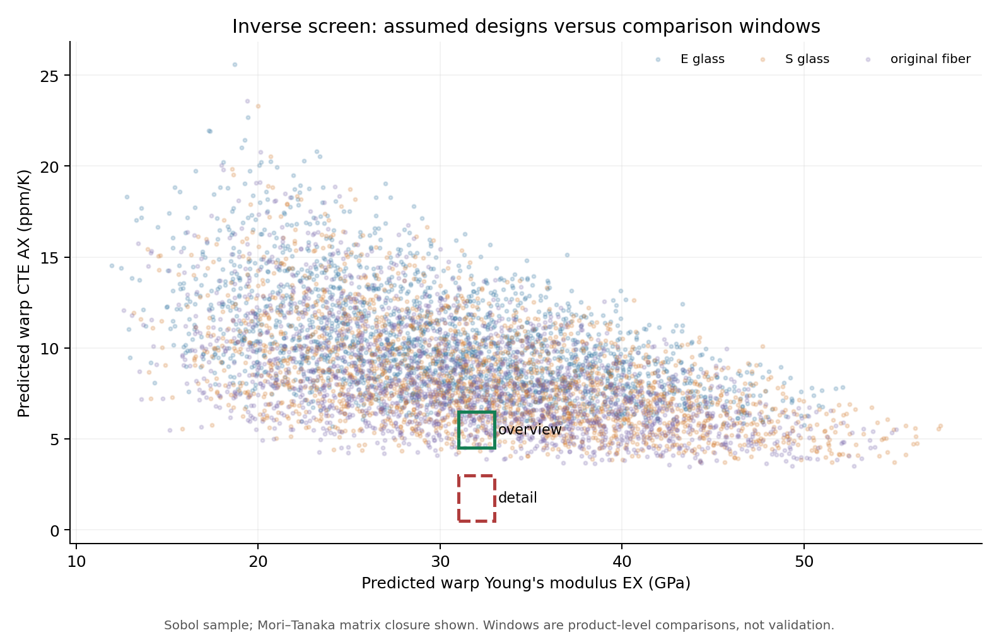
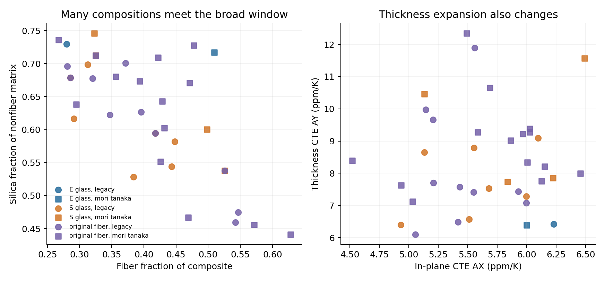
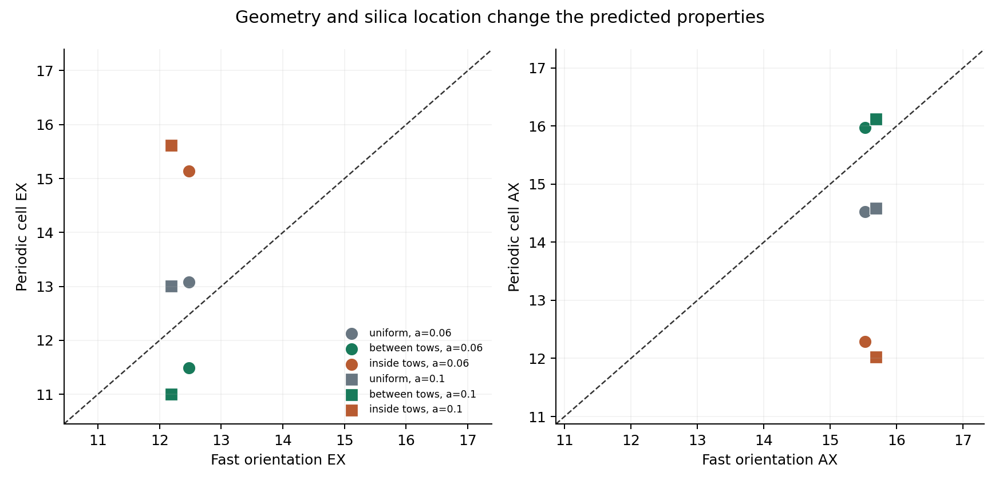

# Inverse design and synthetic weave study

This study concerns the **glass/silica/resin composite substrate**. It does
not model copper or a complete PCB. Project axes are **X and Z in plane, Y
through thickness**. The Resonac catalog uses X/Y in plane and Z through
thickness; compare physical directions, not axis letters.

## What was computed

1. A reproducible, scrambled Sobol screen of **12,288** assumed combinations:
   2,048 shared points for each of three fiber presets and two filled-resin
   closures. Each row contains every input, all 12 properties and flags for
   both comparison windows. This is a finite sample of a continuous design
   space, so it cannot literally enumerate every possible composition.
2. Constrained local searches from the most promising sampled points to
   probe the low-CTE boundary. These searches do not certify a global optimum.
3. Periodic 3D finite-element homogenization of synthetic alternating plain
   weave cells. Tow curvature, resin-rich pockets and silica partition are
   represented explicitly on a voxel mesh. Six independent mechanical
   strains and one temperature increment produce the effective stiffness
   and CTE. The fast orientation model is evaluated at each cell's actual
   global fiber fraction and RMS tow angle.
4. Three coherent 12-property material-card scenarios at **25, 100 and
   150 °C**. Each scenario keeps its composition and weave assumption across
   temperatures. The assumed resin modulus scales by 1, 0.85 and 0.65, and
   resin CTE increases by 0, 5 and 12 ppm/K. These are **illustrative input
   curves**, not measurements or a calibrated temperature law. No Tg or
   viscoelastic behavior is modeled.

The [Chen, Yang and Meguid PCB study](https://www.sciencedirect.com/science/article/pii/S0020768314002625)
is a precedent for multilevel glass/epoxy weave homogenization. The present
geometry and silica partition are new *synthetic scenarios*, not their
measured geometry or a reproduction of their results. The
[Illinois plain-weave study](https://www.ideals.illinois.edu/items/120372/bitstreams/394358/data.pdf)
also found fabric geometry important for modulus and CTE. These papers do
not validate this project's assumed constituent values.

## Assumed inverse-design domain

| Input | Sampled interval or preset |
|---|---:|
| Fiber type | Illustrative E glass: E=76 GPa, ν=.21, CTE=5.6 ppm/K; illustrative S glass: 87, .22, 2.8; original input: 82, .22, 2.49 |
| Fiber volume fraction of whole composite | .25–.65 |
| Silica volume fraction of nonfiber matrix | .25–.75 |
| Unfilled resin modulus, CTE | 1.5–5 GPa; 25–65 ppm/K |
| Silica modulus, CTE | 65–75 GPa; .3–.7 ppm/K |
| Warp and weft effective crimp | 0–20° each |
| Warp family share | .40–.60 |
| Filled-resin model | Supplied empirical formula or bonded-sphere Mori–Tanaka |

The comparison asks for both in-plane Young's moduli to be **31–33 GPa** and
both in-plane CTEs to be either **4.5–6.5 ppm/K** (overview window) or
**0.5–3.0 ppm/K** (detailed window). The
[Resonac catalog](https://www.resonac.com/sites/default/files/2025-03/2025_MCL_EN.pdf)
reports differing Type LH in-plane CTE ranges under differing descriptions;
these product-level laminate figures are **comparison goals**, not measured
properties of this particular modeled composite. Their specimen construction,
copper condition and temperature definition require reconciliation before
calibration. The modulus window is likewise a screening assumption.

## Inverse-screen result

| Outcome | Count among 12,288 model evaluations |
|---|---:|
| Meets overview in warp X only | 165 |
| Meets overview in both in-plane directions X/Z | **37** |
| Meets detailed 0.5–3.0 window in warp X | **0** |
| Same sampled composition meets overview under **both** filled-resin models | **0** |

The 37 broader-window rows span fiber fractions **.267–.628**, silica
fractions **.441–.746** of nonfiber matrix, and resin moduli **1.52–4.96
GPa**. Thus the two comparison targets would not identify a unique
composition. The matrix closure shifts in-plane modulus by a median
**2.74 GPa** among designs meeting the broader window under one closure;
that is larger than the **2 GPa** width of the modulus window. Confirming
filled-resin behavior is therefore more useful than selecting a single
composition from these 37 rows.

**Model-form clarification:** the supplied and Mori–Tanaka filled-resin
CTE equations are algebraically equivalent. They are separate stiffness
closures, not separate thermal-expansion hypotheses for the filled resin.
The [model deep dive](matrix_model_deep_dive.md) adds Hashin–Shtrikman
elastic and Levin thermal bounds and explains why the empty detailed-window
set is conditional on the two implemented closures, not a materials limit.

Constrained local refinement found a best candidate with both in-plane
moduli at **33.0 GPa** and both CTEs at **3.344 ppm/K**. It uses the original
fiber preset, Mori–Tanaka, fiber fraction .514, silica fraction .75, resin
modulus 1.5 GPa and resin CTE 25 ppm/K, with 20° crimp in both directions.
Several inputs sit on search boundaries. Holding the other values fixed,
the model would need resin CTE about **19.5 ppm/K** to reach 3.0, outside
the assumed 25–65 interval. This is a mathematical what-if, not a material
recommendation. The sampled and locally refined result does **not** prove
that a real laminate cannot reach the detailed catalog window.





## What the synthetic weave cells reveal

Each cell has two alternating curved tow families, local tow fiber fraction
.65 and global matrix silica fraction .40. At the 20³ mesh for the larger
crimp amplitude, the actual global fiber fraction is **.1924**. This is a
deliberately resin-rich geometry test, **not** the 31–33 GPa design. All
three silica-placement cases conserve the same overall fiber/silica/resin
fractions at each mesh:

| Silica placement at 20³, amplitude .10 | Cell EX (GPa) | Cell AX (ppm/K) | Fast model EX | Fast model AX |
|---|---:|---:|---:|---:|
| Uniform silica in nonfiber matrix | 13.00 | 14.58 | 12.19 | 15.69 |
| Silica kept between tows | 11.00 | 16.12 | 12.19 | 15.69 |
| Silica concentrated inside tows | 15.61 | 12.03 | 12.19 | 15.69 |

The fast model receives identical global inputs for these three cases, so
it cannot distinguish silica placement. In this synthetic cell, changing
placement at fixed bulk composition changes EX by **4.62 GPa** and AX by
**4.09 ppm/K** between the two extremes. This is a **model sensitivity**,
not an observed processing effect. It is large enough to make silica
location an important unknown if these architectures are plausible.



## Numerical checks and limits

The periodic finite-element solver exactly recovers homogeneous isotropic
input properties in a verification case. All evaluated cell stiffness
matrices are symmetric and positive definite, and lie between the computed
Voigt and Reuss energy bounds. The iterative equilibrium residuals are
below 5×10⁻⁷ relative to each solve's right-hand side. These checks verify
the algebra; they do not validate the geometry or constituent assumptions.

The voxel cell was evaluated at 8³ and 12³ for both crimp amplitudes, and
16³ and 20³ for amplitude .10. At amplitude .10, the 16³→20³ changes in
EX are about **1–2%**; AX changes are about **0.3–1.7%**, depending on
silica placement. The actual voxelized tow fraction also changes with
resolution, so these differences mix geometry discretization and FE error.
Quantitative mesh independence is **not yet established**. The large
silica-placement contrast is more stable than the mesh changes, but its
exact magnitude should not be treated as a production material property.

All nine material-card stiffness matrices have positive eigenvalues
(minimum **4.16 GPa**), zero computed symmetry error and compliance
reciprocity error below 2×10⁻¹⁸ GPa⁻¹. The **low/central/high** names
refer to the 25 °C *warp CTE* among three actual sampled designs that meet
the overview window. They are coherent design examples, **not** statistical
confidence limits or componentwise independent extrema. Their 25 °C
compositions and thermal scenarios are recorded in the full CSV.

| Card at 25 °C | Fiber preset | Fiber fraction | Silica fraction of nonfiber matrix | Filled-resin model | EX / EY / EZ (GPa) | AX / AY / AZ (ppm/K) |
|---|---|---:|---:|---|---|---|
| Low CTE | Original | .572 | .456 | Mori–Tanaka | 31.35 / 18.49 / 32.21 | 4.52 / 8.40 / 4.52 |
| Central CTE | S glass | .418 | .595 | Supplied formula | 32.74 / 25.20 / 32.82 | 5.68 / 7.53 / 5.26 |
| High CTE | S glass | .498 | .600 | Mori–Tanaka | 31.10 / 19.30 / 31.77 | 6.49 / 11.57 / 5.74 |

At 100 and 150 °C, the three cards' in-plane moduli decline under the
assumed resin-softening profile, and some move outside the 25 °C target
window. The [full 12-property card CSV](../results/raw/illustrative_12_property_cards.csv)
contains **EX, EY, EZ, GXY, GYZ, GXZ, NUXY, NUYZ, NUXZ, AX, AY and AZ**
at each temperature, every input assumption, and numerical checks. The
[temperature figure](../results/figures/illustrative_card_temperature.png)
shows the resulting model response. Without measured or justified
temperature-dependent resin data, these rows are scenario illustrations.

The [12-property envelope table](../results/raw/illustrative_property_envelopes.csv)
also gives low, central and high values for **each** of the 12 outputs at
each temperature across the 37 designs selected at 25 °C. Every reported
value names the producing fiber, filled-resin model, sample ID, fractions
and warp/weft crimp. These componentwise extrema need not occur in one
material and should not be pasted together as a single solver card; use
the coherent card CSV for that purpose.

## Reproduce and use next

```powershell
python -m pip install -e ".[test]"
python scripts/inverse_weave_study.py
python scripts/refine_inverse.py
python -m pytest -q
```

The full [inverse sample table](../results/raw/inverse_all_samples.csv),
[37 broader-window combinations](../results/raw/inverse_feasible_overview.csv),
[local refinements](../results/raw/inverse_local_refinements.csv),
[synthetic cell results](../results/raw/synthetic_weave_cells.csv), and
[summary with mesh changes](../results/raw/inverse_weave_summary.json)
permit audit and filtering. There is no `inverse_feasible_detail.csv`
because the sampled detailed-window set is empty.

The next useful computational step is to constrain the inverse search with
**independent constituent information**: a plausible resin CTE/modulus
curve and whether silica can enter tow pores. In the absence of a sample,
obtain process or supplier specifications, weave count/tow geometry, or
micrograph data for a comparable construction. Rebuild the periodic cell
with that geometry and increase mesh resolution until composition and
effective properties stabilize. Keep both filled-resin closures as model
uncertainty until independent evidence distinguishes them. These additions
would turn the current broad sensitivity map into a narrower, testable
material prediction.
