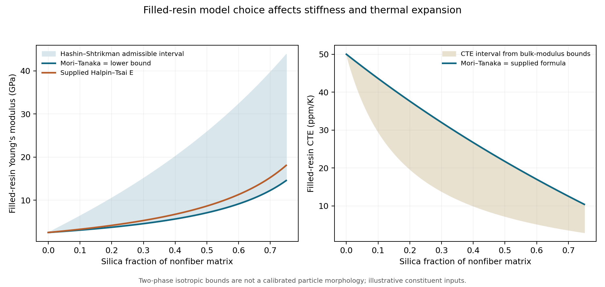

# Which micromechanics model should we trust?

**Answer:** no single model can be designated "best" for this substrate
without knowing its filled-resin morphology or measuring a comparable
material. Mori–Tanaka is a transparent **resin-continuous, spherical-silica
baseline**. In this repository's two-phase isotropic implementation, its
bulk and shear moduli equal the **lower Hashin–Shtrikman bounds**. It is not
an estimate of every possible silica arrangement. The original supplied
Halpin–Tsai-style formula is a distinct stiffness estimate, but its
filled-resin CTE is **algebraically identical** to the current Mori–Tanaka
CTE. Comparing these two options therefore does not bracket the matrix's
thermal-expansion uncertainty.

The distinction matters especially at the repository's illustrative
**70% silica fraction of the nonfiber matrix**. At such loading, filler
packing, contacts, clustering, coatings, voids, and whether the particles
enter the glass tows can control the material response. Literature on
[silica-filled epoxy](https://www.sciencedirect.com/science/article/abs/pii/S1359645402002756)
identifies filler fraction, size, aspect ratio, adhesion and resin
properties as relevant inputs; none is fully specified for this target.

## What the current code actually does

The material hierarchy is:

```text
resin + silica particles -> effective filled resin
filled resin + glass fibers -> unidirectional tow
warp and weft tow segments -> orthotropic woven composite
```

Mori–Tanaka is used only in the **first** step. The tow uses a longitudinal
rule of mixtures and Halpin–Tsai transverse/shear estimates. The fast
weave model rotates and averages tow stiffnesses and thermal stresses.
The separate periodic cell resolves tow paths and resin-rich pockets but
still treats each tow and each matrix voxel as already homogenized phases.
Calling the whole pipeline a "Mori–Tanaka model" hides the other modeling
choices.

For isotropic resin and silica with bulk moduli \(K_r,K_s\), the
filled-resin CTE is tied to its effective bulk modulus \(K\) by the
Levin/Rosen–Hashin relation:

\[
\alpha=\alpha_s+(\alpha_r-\alpha_s)
\frac{1/K-1/K_s}{1/K_r-1/K_s}.
\]

This relation applies to an isotropic, perfectly bonded **two-phase**
thermoelastic composite. It is not limited to Mori–Tanaka. The
[Hashin–Shtrikman elastic bounds](https://garfield.library.upenn.edu/classics1980/A1980JC93400001.pdf)
give an allowable range for \(K\); the relation then yields a CTE range.
The [thermoelastic derivation](https://comptes-rendus.academie-sciences.fr/mecanique/item/10.1016/j.crme.2012.02.016.pdf)
describes this cross-property connection. When silica is stiffer and has
lower CTE than resin, the soft-side bulk-modulus bound gives the **high**
CTE end. That is precisely where the current Mori–Tanaka and supplied CTE
formulas sit.

## Numerical comparison with repository constituents

The table is for the **filled resin alone**, not the final woven composite.
Inputs are resin E=2.5 GPa, ν=.37, CTE=50 ppm/K and silica E=70 GPa,
ν=.17, CTE=.5 ppm/K. \(\phi\) is silica fraction *of the nonfiber matrix*.

| \(\phi\) | Mori–Tanaka E (GPa) | Supplied E (GPa) | HS allowable E (GPa) | Current two-model CTE (ppm/K) | HS-implied CTE range (ppm/K) |
|---:|---:|---:|---:|---:|---:|
| .40 | 5.63 | 6.72 | 5.63–20.19 | 26.70 | 10.00–26.70 |
| .70 | 12.27 | 15.27 | 12.27–39.76 | 12.54 | 3.64–12.54 |
| .75 | 14.55 | 18.08 | 14.55–43.87 | 10.40 | 2.98–10.40 |

These bounds are wide because phase properties and fractions alone do not
specify morphology. The low CTE bound at \(\phi=.75\) shows why the prior
"none reached 0.5–3.0 ppm/K" finding is **specific to the two implemented
closures and sampled design range**, not a physical impossibility. A
2.98 ppm/K *filled resin* does not imply a 2.98 ppm/K *woven composite*;
fiber and architecture must be homogenized consistently. The elastic
upper and CTE lower values are bounds, not a coherent proposed formula or
a recommendation to assume a silica-continuous network.



## Other plausible models, by scale

| Model | Represents | Useful when | Main limitation here |
|---|---|---|---|
| **Hashin–Shtrikman + Levin bounds** | All isotropic, bonded two-phase arrangements consistent with the constituent data | Establishing how much morphology could matter before choosing a closure | Deliberately broad; gives no specific 12-property card |
| **Mori–Tanaka** | Stiff particles embedded in a continuous softer resin; in this code the lower elastic bound | A transparent baseline for dispersed particles | Does not identify clustering, contact networks, voids or tow-scale filtration |
| **Supplied Halpin–Tsai-style E** | Empirical modulus interpolation with an assumed shape parameter | Reproducing the original MATLAB calculation | Shape factor and linear Poisson mixing are not calibrated; its CTE is the same as Mori–Tanaka here |
| **Generalized self-consistent / coated-particle model** | Particle plus interphase or resin shell embedded in an effective medium | Known coating, silane layer or interphase properties | Needs shell thickness and properties; otherwise adds unconstrained fitting parameters. [Coated-sphere example](https://www.sciencedirect.com/science/article/pii/S0020768303002993) |
| **Classical self-consistent model** | Both phases embedded in the unknown effective medium | Exploring a different connectivity hypothesis | Can produce questionable estimates or violate bounds in some settings; must check admissibility. [Comparison](https://www.sciencedirect.com/science/article/pii/S016766360900129X) |
| **Differential effective medium** | Adds filler incrementally to an evolving effective material | Studying an assumed mixing path at high loading | Result depends on that construction path, which is unknown here. [Original formulation](https://www.sciencedirect.com/science/article/pii/016766368590002X) |
| **Lewis–Nielsen packing model** | Empirical effect of shape and maximum packing | Particle size distribution and packing fraction are known | Packing and interface parameters must be supplied or fitted. [Silica/epoxy application](https://www.sciencedirect.com/science/article/abs/pii/S1359645406002369) |
| **Explicit particle RVE (periodic FE or FFT)** | Particle sizes, shapes, clustering, pores, interphases and contacts | Testing specific synthetic morphologies or known micrographs | Computation is more expensive; without geometry data it remains a scenario model |
| **Composite-cylinder assemblage for a tow** | Long fibers with surrounding matrix | Replacing the tow's Halpin–Tsai transverse/shear estimates | Requires tow fiber packing and local matrix properties. The [PCB woven-composite study](https://www.sciencedirect.com/science/article/pii/S0020768314002625) compared CCA, Mori–Tanaka and other schemes at this scale |
| **Periodic woven cell** | Tow curvature, crossing and matrix pockets | Resolving fabric architecture and silica location | Current cells are synthetic and resin-rich; actual tow geometry and mesh convergence remain uncertain |

## Recommendation for this project

1. **Keep Mori–Tanaka as one baseline, not the chosen truth.** Report it
   together with the supplied formula and the HS/Levin bounds. Label
   these as model-form alternatives and admissible limits, respectively.
2. **Do not treat the existing two CTE calculations as independent.**
   Their equality is a consequence of the formulas, and woven-composite
   CTE can still differ between them because their elastic stiffnesses
   differ downstream.
3. **Spend the next computation on morphology, not a third arbitrary
   formula.** At one or two compositions from the 37 broad-window designs,
   build particle-plus-tow scenarios with identical overall phase fractions:
   dispersed silica, tow-excluded silica, tow-infiltrated silica and, if
   defensible, a connected-filler scenario. Run the whole resin→tow→weave
   hierarchy for each. Preserve phase fractions as the mesh is refined.
4. **Rank models using independent information.** Supplier particle-size
   distribution, filler fraction, glass style, resin modulus/CTE versus
   temperature, void content and weave geometry can rule out scenarios.
   Catalog-level modulus and CTE alone cannot identify all these inputs;
   the prior inverse screen found many distinct compositions meeting the
   broader target under one closure.

Without a specimen or independent constituent information, the defensible
output is a **conditional range and sensitivity map**. Selecting a single
"best" model or fitting it to one catalog window would imply precision the
inputs do not support. The full numerical curve is in
[`matrix_model_bounds.csv`](../results/raw/matrix_model_bounds.csv); regenerate
it with `python scripts/matrix_model_deep_dive.py`.
