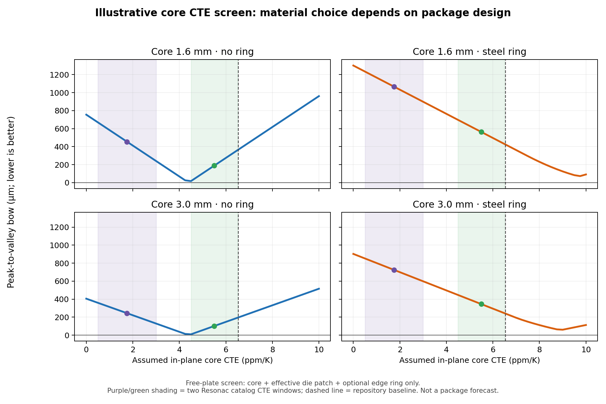
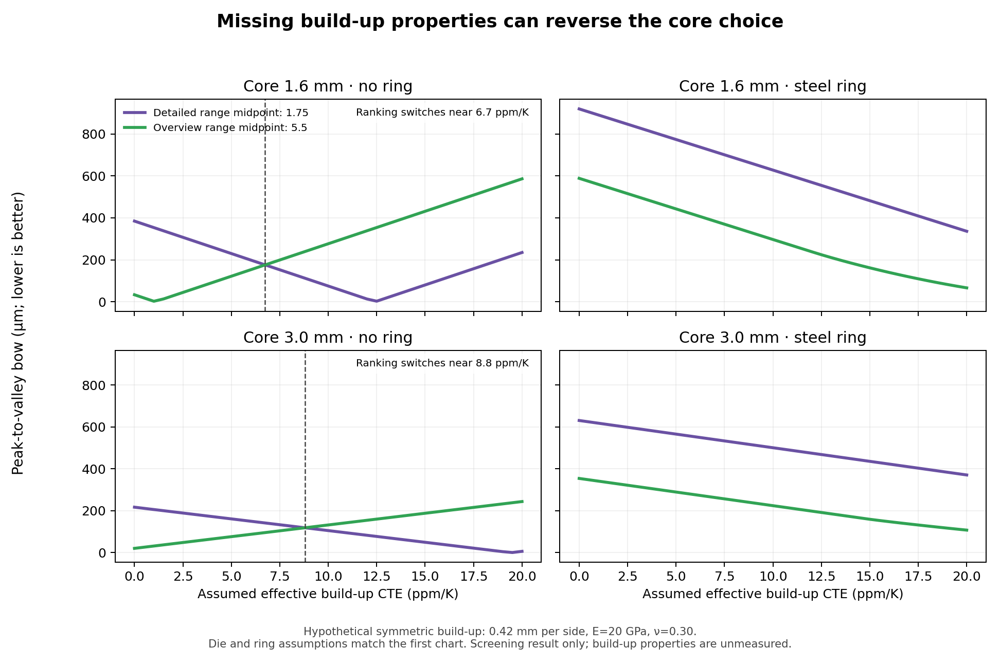

# A first package-level screen, and the measurement it identifies

This study connects the repository's effective core stiffness to a reduced-order
thermal bending model. It is a **conditional screen**, not a validated prediction
of package warpage and not a new plate-mechanics method. Its useful result is
that the preferred core CTE can change when the unmeasured build-up layers are
included. This makes the next measurement request more specific.

## Why two core CTE scenarios?

The [2025 Resonac MCL catalog](https://www.resonac.com/sites/default/files/2025-03/2025_MCL_EN.pdf)
reports two different in-plane CTE ranges for MCL-E-795G Type LH: 4.5–6.5
ppm/°C in the general-characteristics table (labeled below Tg) and 0.5–3.0
ppm/°C in the detailed 0.4-mm laminate table (30–120 °C). The catalog does
not establish why these differ. Their midpoints, 5.5 and 1.75 ppm/K, are
**scenario inputs**, not fitted values or interchangeable measurements.

## What was modeled

The study uses a 100 × 100 mm free core, a centered effective die patch
covering 95% of the 70 × 70 mm interposer area, and an optional 10-mm-wide,
2-mm-thick outer steel ring. These dimensions, the 0.775-mm die thickness,
the 4.4 ppm/K effective die CTE, the 1.6/3.0-mm core choices, and a 150 °C
stress-free temperature come from slides 9–10 of the supplied project deck.
The core's in-plane stiffness is derived from the repository's balanced
cross-ply baseline. The two catalog CTE midpoints replace only its CTE; this
is **not** a self-consistent characterization of Resonac Type LH.

Unknown properties are explicit assumptions: effective die E=130 GPa,
ν=0.28; steel ring E=200 GPa, ν=0.30, CTE=12 ppm/K. The baseline screen omits
build-up, interposer, copper patterning, underfill, EMC, cure shrinkage and
interface details. A second screen inserts a symmetric effective build-up
layer, 0.42 mm per side as in the deck, with **hypothetical** E=20 GPa and
ν=0.30 while sweeping its unknown CTE. These E, ν and CTE inputs are not
reported measurements. All cases cool uniformly from 150 to 25 °C.

At each in-plane position, the model integrates the plane-stress stiffness
through the local stack to form membrane, coupling and bending matrices
`A`, `B` and `D`, and the corresponding thermal force and moment. It minimizes
the resulting elastic energy over smooth symmetric displacement fields.
The output is peak-to-valley out-of-plane displacement. This is a standard
laminate/plate energy calculation; [NIST's multilayer analysis](https://tsapps.nist.gov/publication/get_pdf.cfm?pub_id=852474)
provides background for the `A/B/D` formulation.

## Eight-case base screen: no build-up properties assumed

| Core thickness | Ring | 1.75 ppm/K core bow | 5.5 ppm/K core bow |
|---:|:---:|---:|---:|
| 1.6 mm | No | 455 µm | 189 µm |
| 1.6 mm | Yes | 1,066 µm | 563 µm |
| 3.0 mm | No | 244 µm | 101 µm |
| 3.0 mm | Yes | 725 µm | 345 µm |

These are **model outputs for the simplified stack**, not expected package
measurements. The ring's apparent effect is especially conditional because
its assumed steel CTE and idealized attachment matter. The first chart
shows the full core-CTE response, rather than only these midpoints:

## The more important finding: missing build-up data can reverse the choice

With 0.42 mm of hypothetical effective build-up on each side and E=20 GPa,
the no-ring ranking changes as the build-up CTE changes. For a 1.6-mm core,
an assumed build-up CTE of 10 ppm/K gives **75 µm** for the 1.75-ppm/K core
and **276 µm** for the 5.5-ppm/K core—the reverse of the no-build-up screen.
The 3.0-mm no-ring case likewise changes ranking for sufficiently high
build-up CTE. In this particular sensitivity model, the equal-bow thresholds
are about **6.7 ppm/K** for the 1.6-mm core and **8.8 ppm/K** for the 3.0-mm
core. These thresholds depend on the assumed build-up modulus, thickness,
die and ring properties. They are not measured specifications or evidence
that 10 ppm/K is the actual build-up CTE.

Holding the hypothetical 0.42-mm build-up thickness fixed, the switch itself
moves when the assumed build-up modulus changes:

| Effective build-up E | Switch: 1.6-mm core | Switch: 3.0-mm core |
|---:|---:|---:|
| 10 GPa | 9.1 ppm/K | 13.2 ppm/K |
| 20 GPa | 6.7 ppm/K | 8.8 ppm/K |
| 40 GPa | 5.6 ppm/K | 6.6 ppm/K |

Thus **both E and CTE of the build-up stack** are needed before choosing a
core CTE. The table is a sensitivity exercise over assumed values, not a
probability range.

The requested physical-project input is therefore the **effective build-up
stack properties and thickness after processing**, in addition to the core
properties. A core CTE target selected in isolation can be wrong for the
package. The catalog discrepancy remains important, but resolving it alone
will not establish the best core design.

## Verification and limits

- A full-coverage two-layer limit agrees with the exact `A/B/D` solution.
- Uniform CTE or zero temperature change produces zero bow, including with
  optional build-up and ring.
- Raising the polynomial order from 6 to 8 changes the eight reported bow
  values by about 2–7%; rankings remain unchanged. This is a numerical
  stability check, not validation against physical packages.
- The model assumes linear elasticity, uniform temperature, flat initial
  shape, perfect bonding, a free plate and smooth symmetric deformation.
  It cannot resolve local die-edge stress, ring attachments, asymmetric
  routing, viscoelasticity, cure shrinkage or the omitted package layers.
- No material or package measurements were used for fitting or validation.
  Do not use the µm values as specifications or a material selection rule.

## Concrete next handoff

1. Obtain the effective build-up stack's in-plane E(T), ν(T), CTE(T) and
   post-cure thickness, or the constituent and copper-pattern data needed
   to derive them. Confirm the die/interposer and ring attachment geometry.
2. Obtain a direction- and temperature-resolved core property card from
   coupons of the actual woven material. Record process history, filler
   content, porosity and glass architecture. Ask Resonac which Type LH CTE
   table describes the relevant test condition.
3. Feed these measured cards and both catalog scenarios into the existing
   package finite-element model, at the actual process temperatures. Compare
   predicted *warpage-versus-temperature curves* with measured packages.
   Hold out at least one core design for a true prediction check.

Run `python scripts/package_warpage_screen.py` to regenerate both figures and
the raw CSVs. The implementation is in
`src/composite_research/package_screen.py`; verification cases are in
`tests/test_package_screen.py`.
