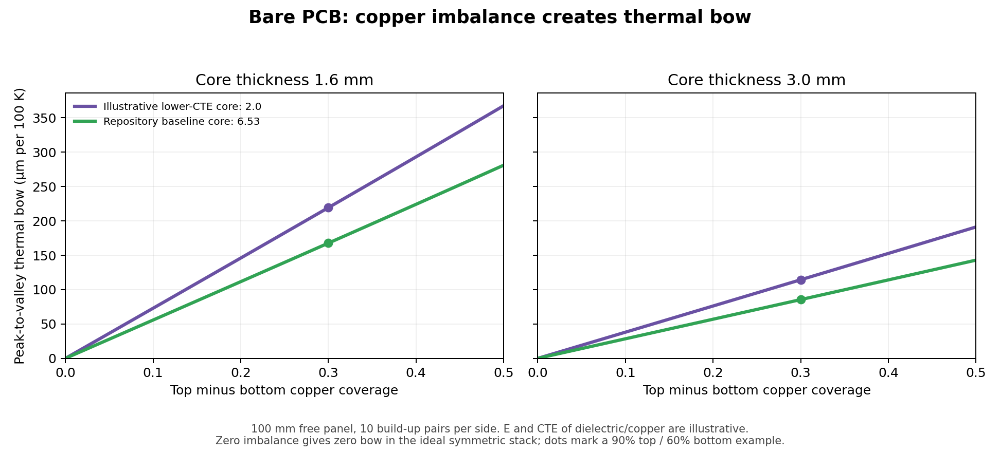
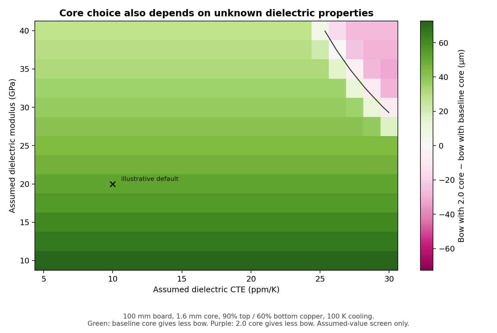

# Bare-PCB thermal laminate screen

## What this answers

This is a **bare board or substrate** model. There is no die, interposer,
populated component, stiffener or ring. It connects the repository's
calculated composite-core properties to the thermal expansion and bow of a
multilayer board. The useful result is that **core CTE alone cannot determine
bare-board warpage**. The top and bottom layer stack and copper pattern matter.

This is a standard classical laminate calculation, not a new mechanics
method or a validated forecast for the physical board.

## Resonac numbers and model inputs are different things

The [Resonac MCL catalog](https://www.resonac.com/sites/default/files/2025-03/2025_MCL_EN.pdf)
lists MCL-E-795G Type LH in-plane CTE as 4.5–6.5 ppm/°C in its overview
table (below Tg) and 0.5–3.0 ppm/°C in the detailed table (30–120 °C).
Both appear under a **copper-clad laminate product**, not an isolated
resin/fiber core constituent. The tables do not give enough specimen and
temperature-history detail to reconcile the ranges or to assign either
range as the CTE of the core layer inside a different PCB stack. The earlier
package screen made that assignment and has been removed.

The corrected figures use two explicitly different *core input scenarios*:
the repository's illustrative baseline in-plane CTE of 6.53 ppm/K and an
arbitrary lower-CTE core of 2.0 ppm/K. The 2.0 value is a sensitivity input,
not a Resonac measurement or a fitted material. The catalog ranges remain
external laminate-level benchmarks for a matched construction and test.

## How the board model works

The model places a composite core between bottom and top effective build-up
stacks. The core in-plane stiffness comes from the repository's audited
cross-ply model. Each build-up stack is approximated as dielectric plus
area-averaged copper, with separate top and bottom copper coverage. The
model integrates each layer through thickness to form the conventional
membrane, coupling and bending stiffness matrices `A`, `B`, `D`, then solves
for the free midplane strain and curvature under a uniform temperature
change. Board bow is calculated from that curvature. This is an idealized
use of [classical laminate mechanics](https://tsapps.nist.gov/publication/get_pdf.cfm?pub_id=852474).

The illustrative screen uses 10 pairs of 12-µm copper and 30-µm dielectric
per side, 1.6- and 3.0-mm core options, and nominal 75% copper coverage,
following the layer dimensions in the supplied project deck. It uses a
100-mm square free panel and reports response to **100 K of cooling**, not
bow at a claimed process temperature. The dielectric E=20 GPa,
ν=0.30 and CTE=10 ppm/K, and copper E=110 GPa, ν=0.34 and CTE=17 ppm/K,
are **illustrative assumptions**; they were not measured for this board.
The copper/dielectric mixture is an in-plane isostrain approximation and
does not resolve individual traces.

## Main result

If the top and bottom build-up stacks are identical, this free, linear,
uniform-temperature model gives **zero bow**, for either core CTE. Their
thermal bending moments cancel. The board still changes length: in the
illustrative 1.6-mm symmetric stack, the calculated in-plane board CTE is
about 6.95 ppm/K with the 2.0-ppm/K core and 9.65 ppm/K with the repository
baseline core. These are model outputs for the assumed stack, not catalog
matches.

To show the consequence of asymmetry, the script also uses a purely
illustrative **90% top / 60% bottom** copper-coverage example:

| Core thickness | Core CTE scenario | Symmetric copper bow | 90% top / 60% bottom bow |
|---:|---:|---:|---:|
| 1.6 mm | 2.0 ppm/K | 0 | 219 µm per 100 K |
| 1.6 mm | Repository baseline 6.53 ppm/K | 0 | 168 µm per 100 K |
| 3.0 mm | 2.0 ppm/K | 0 | 114 µm per 100 K |
| 3.0 mm | Repository baseline 6.53 ppm/K | 0 | 86 µm per 100 K |

The second figure varies the unknown dielectric modulus and CTE. A different
assumed dielectric can change which core scenario has less bow, even at
fixed copper imbalance. The decision therefore cannot be made from a core
CTE target by itself.

## What would make this useful for the physical PCB

1. Provide the **actual bottom-to-top stack-up**: each dielectric thickness,
   copper thickness and top/bottom copper coverage or artwork. Record the
   board outline and which layers are patterned. A mean coverage is only a
   first screen; local copper maps are needed if bow is not nearly uniform.
2. Measure or obtain the actual core and dielectric **in-plane modulus and
   CTE versus temperature**, plus the relevant process state and moisture
   condition. Record whether Resonac's reported CTE is for a copper-on or
   copper-removed specimen and the test temperature interval.
3. Measure an unrestrained bare board's shape over the relevant thermal
   cycle, including initial shape. IPC's [bow and twist test method](https://www.ipc.org/sites/default/files/test_methods_docs/2.4.22.1c.pdf)
   is a useful measurement reference, though its reported quantity is not
   identical to this model's peak-to-valley thermal increment. Compare a
   measured **change in shape** with the predicted increment.
4. Use the measured stack in this model as a fast screen. If local traces,
   weave anisotropy, moisture, cure stress, viscoelasticity or temperature
   gradients dominate, move to a patterned shell or 3D model and calibrate
   it against the board measurements.

## Verification and limits

The tests show zero bow for a symmetric stack, zero response with uniform
CTE or zero temperature change, sign reversal when top and bottom copper
coverage swap, the exact equal-stiffness bilayer curvature, and the expected
square-of-length bow scaling. These are mathematical checks, not physical
validation. Initial bow, fabrication residual stress, copper plasticity,
moisture, local copper geometry and nonlinear support conditions are not
modeled. Do not use the µm values as a board acceptance prediction.

Run `python scripts/pcb_warpage_screen.py` to regenerate the figures and
scenario CSVs. Source: `src/composite_research/pcb_laminate.py`; checks:
`tests/test_pcb_laminate.py`.
