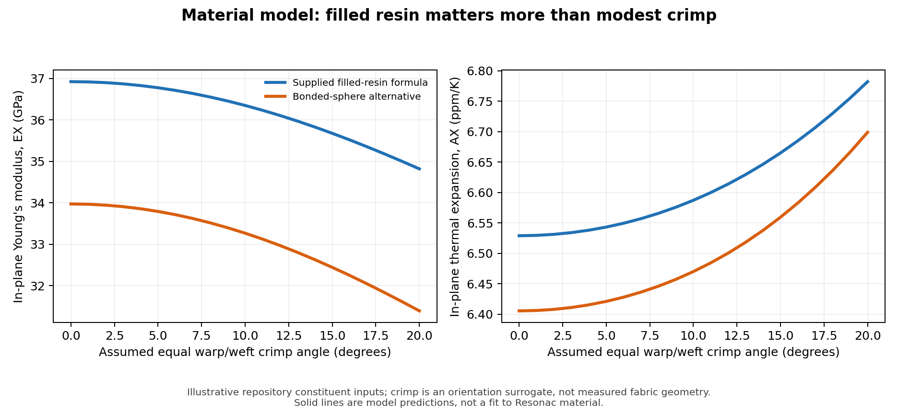
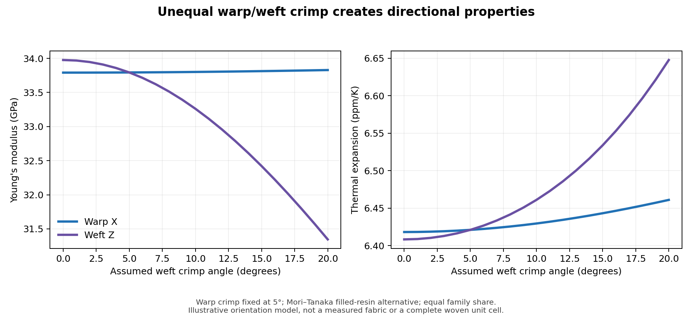

# Modeling the composite's CTE and mechanical properties

## The output you can use

The model produces a **material card** with nine elastic engineering
constants (three Young's moduli, three shear moduli, three Poisson ratios)
and three thermal expansion coefficients. The repository convention is
**X and Z in the fabric plane; Y through thickness**. Stiffness is in GPa
and CTE in ppm/K. A separate row can be calculated for each temperature
where constituent data are available. This is the composite material itself;
the model has no PCB copper, die, package or ring.

`NUij` means the negative transverse strain in direction `j` divided by
the imposed strain in direction `i` under uniaxial stress in direction `i`.

## How it is calculated

1. Mix resin and silica to estimate a filled matrix. The original MATLAB
   formula and a bonded-sphere Mori–Tanaka alternative are both available.
   At the example's very high silica loading, neither alternative is
   guaranteed to describe the actual processed material.
2. Combine that filled matrix with glass fiber to obtain a unidirectional
   fiber-rich material, including its stiffness and thermal expansion.
3. Form two fiber families: warp along X and weft along Z. Tilt each family
   out of plane by user-supplied **effective** warp and weft crimp angles.
   Each family is represented by equal positive/negative tilt segments,
   rather than a resolved sinusoidal tow path. Rotate the full
   3D stiffness and thermal eigenstrain, then average the corresponding
   **thermal stresses**, so CTE remains consistent with the effective
   stiffness. At zero crimp and equal family share, this reproduces the
   repository's consistent 0/90 cross-ply calculation.
4. Convert the effective stiffness to the 12 material-card values.

This is an **orientation-based woven surrogate**, not a fully resolved weave
unit cell. It lacks tow cross-sections, resin-rich pockets, contact,
porosity, interfaces and local stress redistribution. Uniform-strain
orientation averaging generally makes it a stiffness upper-bound-style
screen rather than a validated prediction. Published woven glass/epoxy
work for circuit-board substrates measured warp and fill geometry and
found that crimp affects directional modulus and CTE; see the
[Illinois thermoelastic study](https://www.ideals.illinois.edu/items/120372/bitstreams/394358/data.pdf).
The [follow-on inverse and periodic-cell study](inverse_weave_study.md)
tests the missing geometry and silica-location assumptions explicitly.

## A useful conclusion from the current illustrative inputs

The following are **unvalidated calculations** with the repository's
example constituents, not predictions for Resonac Type LH:

| Filled-matrix model | Equal crimp | In-plane E | In-plane CTE | Thickness E | Thickness CTE |
|---|---:|---:|---:|---:|---:|
| Supplied formula | 0° | 36.92 GPa | 6.529 ppm/K | 30.59 GPa | 9.407 ppm/K |
| Supplied formula | 10° | 36.35 GPa | 6.587 ppm/K | 30.25 GPa | 9.258 ppm/K |
| Mori–Tanaka | 0° | 33.97 GPa | 6.405 ppm/K | 26.54 GPa | 10.032 ppm/K |
| Mori–Tanaka | 10° | 33.27 GPa | 6.470 ppm/K | 26.10 GPa | 9.858 ppm/K |

For these inputs, changing the filled-matrix model changes in-plane modulus
by about **3 GPa**. Adding 10° of symmetric crimp changes it by about
**0.6–0.7 GPa**. Crimp raises the predicted in-plane CTE slightly; it
cannot be used as an arbitrary adjustment to force a very low CTE target.
This points to the **actual filled resin's measured properties** as the
first high-value input for stiffness prediction.



Unequal crimp gives different warp and weft properties even at equal family
share. In one illustrative Mori–Tanaka case with 5° warp and 15° weft
crimp, EX=33.81 GPa and EZ=32.42 GPa, while AX=6.443 and AZ=6.534 ppm/K.
The effective crimp angles should be estimated from fabric geometry or
remain labeled sensitivity assumptions; they are not automatically the
maximum local angle of a curved tow.



## How to use the material-card tool

Copy `data/material_card_input_example.csv` and replace its illustrative
row with **measured** constituent data. Use one row per temperature. Fields
`ef`, `ep`, `er` are fiber, silica and resin Young's moduli in GPa;
`nuf`, `nup`, `nur` are Poisson ratios; `af`, `ap`, `ar` are CTEs in ppm/K;
`vf` is fiber volume fraction of the entire composite; `phi` is silica
volume fraction **within the non-fiber matrix**. The three final fields
specify warp crimp angle, weft crimp angle and warp share. A balanced
fabric has warp share 0.5, but equal yarn count alone does not establish
equal fiber volume in the two families.

```powershell
python scripts/material_card.py data/material_card_input_example.csv results/raw/material_card_example.csv --matrix-method mori_tanaka
```

The resulting CSV contains the nine elastic constants and three CTEs at
the input temperature. The example row at 25 °C is inherited from the
original illustrative study; it is **not** a measured material. The tool
does not infer temperature behavior from that row. A real temperature-
dependent card requires properties measured or justified at each relevant
temperature, especially across the resin glass transition.

If the **filled resin has been measured directly**, use
`data/material_card_measured_matrix_template.csv` instead. Enter the
measured filled-matrix `em_measured` (GPa), `num_measured`, and
`am_measured` (ppm/K) along with the fiber and fabric fields; silica and
unfilled-resin guesses are then unnecessary:

```powershell
python scripts/material_card.py data/my_measured_matrix.csv results/raw/my_material_card.csv --matrix-method measured
```

The template has a header and no data row, so it cannot silently generate
a card from invented measurements.

## What would make the model predictive

1. Identify the actual glass type and measure fiber fraction, silica
   fraction, void fraction and warp/weft fabric geometry on the same
   processed material. Photograph cross-sections to estimate tow paths
   and crimp in each direction.
2. Measure **filled resin** E, Poisson ratio and CTE versus temperature
   after the same cure and moisture conditioning as the composite.
   These data decide whether either filled-matrix formula is credible;
   the card tool can use the measurements directly.
3. Measure **unclad composite coupons** in warp, weft and thickness
   directions for modulus and CTE, with Poisson/shear data where feasible.
   Reserve some coupons or temperatures for a prediction check rather
   than fitting all measurements. Compare tensile modulus with tensile
   modulus, not flexural modulus.
4. Only after that check, pass the temperature-specific 12-property card
   to a board or package model. If the orientation surrogate misses the
   held-out measurements, move to a measured-geometry weave unit cell.

The [Resonac catalog](https://www.resonac.com/sites/default/files/2025-03/2025_MCL_EN.pdf)
reports different in-plane CTE ranges for MCL-E-795G Type LH in its
overview and detailed tables. They are **product-level laminate data with
different stated temperature descriptions**. The published tables do not
identify all specimen details needed to treat either as the CTE of the
resin/fiber/filler composite used in this model. Confirm the actual test
specimen, copper condition, temperature interval and weave before using
the catalog to calibrate any constituent property.

## Verification and files

`tests/test_woven.py` checks the zero-crimp cross-ply limit, 3D rotation
of isotropic properties, positive stiffness and warp/weft exchange.
`tests/test_material_card.py` checks multi-temperature-row output and
rejects missing inputs. The study curves and CSVs can be regenerated with
`python scripts/woven_material_screen.py`. Implementation is in
`src/composite_research/woven.py` and `scripts/material_card.py`.
